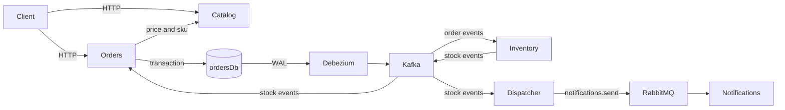

# Market architecture

Market is five processes. Each process that stores data uses its own Postgres database. No service reads another service's tables.

## Why each broker exists

Postgres is the system of record. Catalog stores price and a published flag. Orders stores the order. Inventory stores `onHand`. Notifications stores the in-app notification. One Postgres server hosts the four databases. `wal_level=logical` is set so Debezium can read the orders write-ahead log.

Orders writes the order row and an outbox row in one database transaction. The orders process does not produce to Kafka. Debezium's Postgres connector tails `public.outbox` and the outbox EventRouter publishes `payload` to the topic named by `aggregate_type`. Deleted rows do not emit tombstones.

Kafka is the domain event bus. The topics are `orders.order-placed`, `orders.order-cancelled`, `inventory.stock-reserved`, and `inventory.reservation-failed`. Each value is JSON with `eventId`, `eventType`, `occurredAt`, `aggregateId`, and `data`.

Inventory consumes the order topics as group `inventory-service`. A repeated `eventId` does not change stock twice. A short stock check publishes `inventory.reservation-failed` and does not decrement `onHand`. Inventory writes the outgoing event in the same transaction as the stock change and publishes it after commit. A crash before publish leaves `published_at` null, and the redelivery publishes that row without decrementing again.

Orders consumes the inventory topics as group `orders-service` and updates its own order status. `placed` becomes `reserved` or `rejected`. A later cancel writes `orders.order-cancelled`. Status does not move backward from `cancelled`.

RabbitMQ is for work, not domain facts. The dispatcher consumes the two inventory topics and emits a command to `notifications.send`. Notifications acks after the row is stored. A failure nacks without requeue, and the queue's dead-letter exchange routes the message to `notifications.send.dlq`. Prefetch is 10.

The remaining crash window is a dispatcher crash after Kafka has delivered the event and before RabbitMQ has accepted the command. Kafka redelivers that event. Notifications dedupe on `commandId`, which is the inventory `eventId`.

HTTP is the only synchronous call, and the only one is orders to catalog, before the orders transaction starts.
